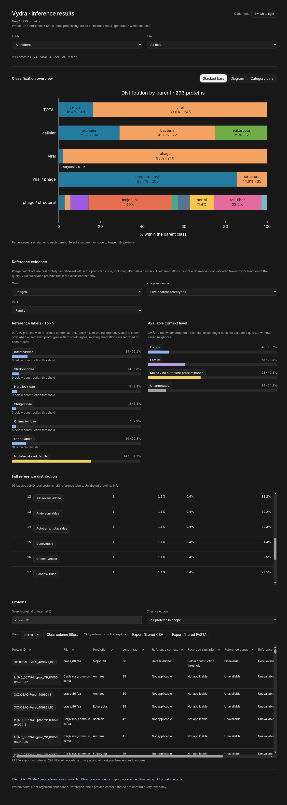

<div align="center">
  
  <h1>Vydra</h1>
  <p><strong>Classify protein sequences and inspect the biological evidence behind their predictions.</strong></p>
  <p><a href="README.md">English</a> · <a href="README.es.md">Español</a> · <a href="https://github.com/Maxdesigna7x/Vydra/issues">Report a problem</a></p>
  <p>Local browser interface · CPU or NVIDIA GPU · Interactive reports · CSV and FASTA exports</p>
</div>

Vydra analyzes **amino-acid sequences** in protein FASTA files. It distinguishes cellular and viral proteins, separates bacteriophages from eukaryotic viruses, and predicts ten structural components of phages. For phage proteins, it also retrieves nearby reference proteins and their annotations so you can inspect the evidence.

**Research software:** predictions and reference annotations support biological interpretation. They do not establish a query's species, host, or experimentally confirmed function.

[Install](#install-once) · [Run the interface](#analyze-your-proteins) · [Read the results](#understand-the-results) · [Export proteins](#filter-and-export) · [Troubleshooting](#troubleshooting)

## What you receive

| Result | What it tells you |
|---|---|
| Cellular classification | Bacteria, Archaea, or Eukaryota. |
| Viral classification | Phage or eukaryotic-virus protein. |
| Eukaryotic-virus group | One of 978 protein groups, with published VirDetect-AI class annotations. These are not 978 species or 978 distinct functions. |
| Phage structural category | Baseplate, collar, head–tail joining, major/minor capsid, major/minor tail, portal, tail fiber, or tail sheath. |
| Phage reference evidence | Up to five nearest prototypes within the predicted class, their similarities and individual annotations, plus context from the assigned cluster. |
| Saved report and files | An interactive HTML report, complete prediction tables, input provenance, run timings, and filtered exports. |

All inference runs on your computer. Internet access is needed only to obtain software, models, and reference banks when they are not already installed.

## Before you start

- **Input:** protein FASTA files containing amino acids. DNA/RNA must first be translated with a suitable gene-prediction workflow; Vydra does not translate nucleotide sequences.
- **Platform:** Linux is the validated local runtime. Other operating systems have not been validated.
- **Software:** Git and [Conda](https://docs.conda.io/projects/conda/en/stable/user-guide/install/index.html). Conda creates an isolated environment containing Vydra's dependencies. You do not need to install Python packages individually.
- **Storage:** plan for about 25 GB free for software, models, and small runs; large inputs and reports require extra space.

| Execution | Environment | Hardware guidance |
|---|---|---|
| CPU | `vydra-cpu` | No GPU needed; slower inference. |
| NVIDIA GPU | `vydra` | CUDA support required; validated on RTX 3060 with 12 GB VRAM. This environment can also use CPU. |
| Viewing a saved report | No Conda environment needed | A modern browser; memory needs grow with report size. |

**32 GB RAM is recommended.** 16 GB is an estimated practical minimum for small inputs with batch size 1, not a certified minimum. Longer proteins and larger inputs may require more. See the [CPU/GPU validation and RAM measurements](docs/CPU_GPU_VALIDATION.md).

## Install once

Open a terminal and clone the repository:

```bash
git clone https://github.com/Maxdesigna7x/Vydra.git
cd Vydra
```

Choose **one** environment:

<details>
<summary><strong>CPU installation — no NVIDIA GPU required</strong></summary>

```bash
conda env create -f environment-cpu.yml
conda activate vydra-cpu
```

</details>

<details>
<summary><strong>NVIDIA GPU installation</strong></summary>

```bash
conda env create -f environment.yml
conda activate vydra
```

</details>

With that environment active, download the models and check the installation:

```bash
./vydra download-artifacts
./vydra download-model
./vydra doctor
```

The classifier weights and reference annotations are included in the repository. The two large reference banks are downloaded separately, about 1.6 GB combined; the pinned ProstT5 encoder requires about 5.3 GB. Downloads are reused in later runs. Do not install CPU and GPU FAISS variants together in one environment.

## Analyze your proteins

After installation, open a terminal in the repository folder and start the interface. The launcher activates Conda for you:

```bash
# NVIDIA/GPU environment, also capable of CPU inference
./run_vydra_ui.sh

# CPU-only environment
VYDRA_CONDA_ENV=vydra-cpu ./run_vydra_ui.sh
```


1. Select a **protein FASTA file** or a **folder**. Folders are searched recursively; keeping one file per sample preserves sample provenance.
2. Choose a **new or empty output folder outside the input folder**.
3. Keep **Generate inference report** enabled. Automatic device selection uses a compatible GPU when available, otherwise CPU.
4. Start the run. Progress shows the processing stage, classified-protein counts when available, and elapsed time.
5. Select the completed run in the history to open its results. You can also open the saved `informe_inferencia/informe.html` directly in a browser.

**Keep the server terminal open.** Closing the browser tab leaves inference running; Ctrl+C in the terminal stops the server and its active run. Cancellation retains partial output, so restart in a new folder.

The interface and report are currently in English. The CLI offers English and Spanish messages. Advanced settings include batch size, device, model-download permission, and report generation. **Check installation** is optional; models are used locally without pressing it.

## Understand the results

The report separates **model predictions**, **annotations of nearby references**, and **context of the reference group**.

<p align="center">
  <a href="docs/images/inference-results.jpg"></a>
</p>

*Example saved report with 293 protein records. Counts and timings describe this particular run; they are not an accuracy benchmark. Click the image to view it at full resolution.*

- **Classification overview:** counts of predicted proteins at each step. Percentages use the corresponding parent category; they do not measure organism or virus abundance.
- **Phage reference evidence:** five nearest prototypes from the predicted class, including other clusters as alternatives. The initial reference view shows a genus/family label only when all retrieved neighbors with that field agree. Open a protein's detail to see how many annotations are available and where they disagree.
- **Cluster context:** a secondary view of the whole assigned cluster, which may be larger and more diverse than the local neighborhood.
- **Eukaryotic-virus class context:** published group annotations, including representative accession, protein description, function category, and taxonomic context when available. This branch does not use FAISS retrieval.
- **Timing:** inference time and total processing time, including report generation when enabled; these are whole-run times, not per-protein timings.

Three quantities must be read separately:

| Quantity | Interpretation |
|---|---|
| Classifier score | Softmax preference for a category at one classification step; not calibrated biological accuracy. |
| Reference similarity | Cosine similarity between embeddings; not amino-acid identity or probability of a shared function. |
| Annotation agreement | Agreement among references with known annotations, accompanied by coverage; not independent evidence from five unrelated organisms. |

A construction threshold is reported for phage clusters. Being above it does **not** validate the new query; the engine retains the nearest-cluster assignment even below it. `Hypothetical protein` or `uncharacterized protein` means the source annotation supplies no specific function. Vydra preserves this text as reference information instead of claiming it as a known function of the query.

## Filter and export

Use the final protein table to combine filters such as **Collar + reference genus + reference family**. Choose whether phage taxonomy refers to the five nearest prototypes or the assigned cluster.

- **Export filtered CSV:** exports every matching row, with reference evidence and annotations.
- **Export filtered FASTA:** exports every matching original protein, including matches on other pages. Complete original headers, repeated original IDs, residue spelling, and terminal `*` are preserved; line wrapping is normalized.

The HTML embeds compressed original sequences for portable offline FASTA export. Export requires a modern browser and available original sequences. Embedding-only inputs and older runs without original-sequence snapshots cannot supply FASTA. Old predictions also cannot acquire five saved neighbors simply by regenerating the report; a new inference is needed.

### Files to keep

GUI runs save these files inside the selected output folder:

| File | Purpose |
|---|---|
| `informe_inferencia/informe.html` | Open to explore the results; works offline. |
| `predicciones_completas.csv` / `.jsonl` | Complete per-protein predictions and evidence. CSV contains numbered columns for the five neighbors. |
| `manifest_secuencias.csv` | Maps internal IDs to original headers, files, and lengths. |
| `secuencias_excluidas.csv` | Records excluded during input preparation and their reasons. |
| `original_sequences.jsonl` | Original headers and residues used for FASTA export and report regeneration. |
| `metadata_inferencia.json` | Settings, paths, models, run status, and timings. |
| `informe_inferencia/tiempos.csv` | Inference, report, and total processing times. |
| `informe_inferencia/secuencias.csv.gz` | Additional complete table, compressed without data loss. |

CSV files grow with the annotations of five neighbors; gzip saves space because reference text often repeats. The HTML size also grows with its embedded evidence and compressed sequences. Keep predictions, source inputs, snapshots, and metadata together for reproducibility. [Complete output guide](vydra_core/SALIDAS.md).

## Troubleshooting

| Problem | What to do |
|---|---|
| `conda` is not found | Install Conda, reopen the terminal, then follow its initialization instructions. The launcher also accepts `VYDRA_CONDA_ROOT=/path/to/conda`. |
| The launcher cannot activate the environment | Finish installation; CPU users must set `VYDRA_CONDA_ENV=vydra-cpu`. |
| Models or reference banks are missing | Activate the chosen environment; run `download-artifacts`, `download-model`, then `doctor`. |
| CUDA is unavailable | Select CPU or Automatic; CPU inference does not require CUDA. |
| Memory is insufficient | Close other heavy workloads and try Batch size = 1. Large inputs may need more RAM. |
| Input records were excluded | Check `secuencias_excluidas.csv`; verify that the input contains protein sequences. |
| FASTA export is unavailable | Check for original sequence snapshots and use a modern browser. Embeddings alone contain no recoverable residues. |
| The browser does not open | Run `./run_vydra_ui.sh --no-browser --port 8732` and open the printed local URL. Add the CPU environment override if needed. |

For offline operation, disable **Allow model downloads** after the models and banks are installed. This prohibits missing-model downloads, not local model use. [Usage FAQ](docs/GUI_FAQ.md).

## Command-line use

For automation or larger workflows, activate the appropriate Conda environment and use:

```bash
./vydra predict --fasta proteins.faa --format csv --output results/predictions.csv
./vydra predict --offline --device cpu --fasta proteins.faa --format jsonl --output results/predictions.jsonl
./vydra predict --embedding embeddings.npy --offline --format json
```

With `--output`, the CLI generates a report by default; `--no-report` disables it. Without `--output`, predictions go to the terminal and no report is created. CLI report folders are named `informe_inferencia_<output_stem>/`. [CLI guide](vydra_core/CLI.md).

<details>
<summary><strong>Technical overview and validation</strong></summary>

ProstT5 produces a 1,024-dimensional embedding shared by six MLP heads. A protein visits only the decisions on its predicted route.

| Head | Decision |
|---|---|
| M1 | Cellular / viral |
| M2 | Bacteria / Archaea / Eukaryota |
| M3 | Phage / eukaryotic virus |
| M4 | 978 eukaryotic viral protein groups |
| M5 | Structural / non-structural phage |
| M6 | Ten structural categories |

Phage assignments use exact FAISS inner-product search on normalized reference embeddings within the predicted class. Five retrieved prototypes provide descriptive evidence; the first preserves the existing nearest-cluster assignment. Proteins longer than 2,048 amino acids use overlapping windows whose embeddings are averaged.

CPU/GPU execution checks and RAM measurements are documented separately from biological performance. Internal head evaluations do not establish end-to-end accuracy on arbitrary external samples. Reference coverage, annotation quality, short fragments, and earlier classification errors affect interpretation. Additional taxonomic or functional transfer rules require independent evaluation.

- [Biological evidence and export design](docs/EVIDENCIA_BIOLOGICA_Y_EXPORTACION.md)
- [CPU/GPU validation](docs/CPU_GPU_VALIDATION.md)
- [RTX 3060 batch benchmark](docs/BATCH_BENCHMARK_RTX3060.md)
- [Historical classifier evaluation figure](docs/images/classifiers-en.png)

Run software regression checks with `python -m unittest discover -s tests -p 'test_*.py'` in the installed environment. Software tests do not certify biological accuracy.

</details>

## Documentation and support

Current CLI: **0.4.0**. [Changes in this version](CHANGELOG.md).

- [GUI guide](vydra_core/GUI.md) and [usage FAQ](docs/GUI_FAQ.md)
- [CLI guide](vydra_core/CLI.md) and [output dictionary](vydra_core/SALIDAS.md)
- [Reference evidence, FASTA export, and timings](docs/EVIDENCIA_BIOLOGICA_Y_EXPORTACION.md)
- [Report guide](docs/INFORMES_INFERENCIA.md)
- [Report an issue](https://github.com/Maxdesigna7x/Vydra/issues): include your command/settings, error log, device, and software revision; a small reproducible input helps when it can be shared.

Vydra is part of an ongoing thesis project. Until a formal publication is available, cite this repository and record its commit, model/reference versions, and analysis settings. Do not cite the results screenshot as evidence of predictive accuracy.
