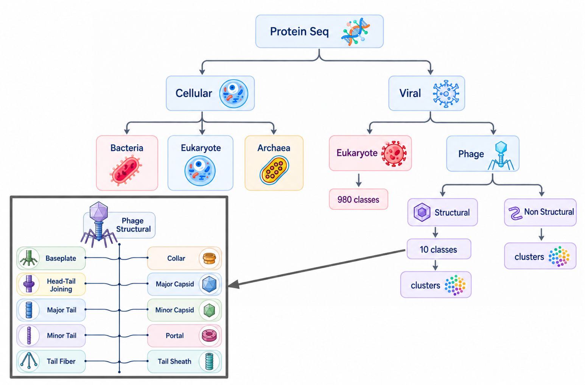
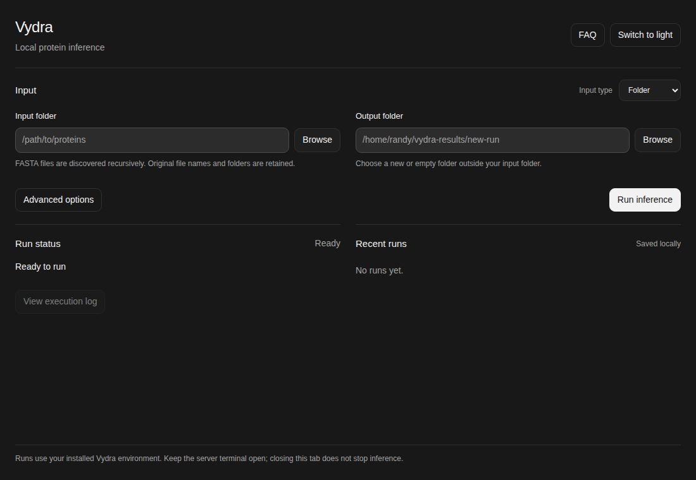
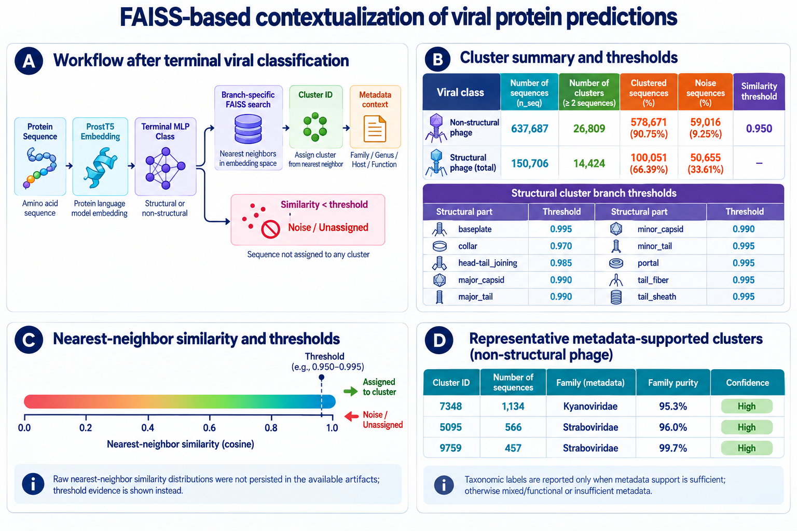
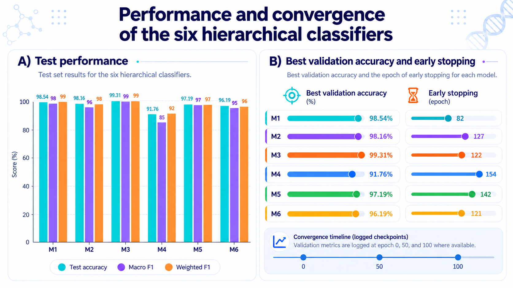
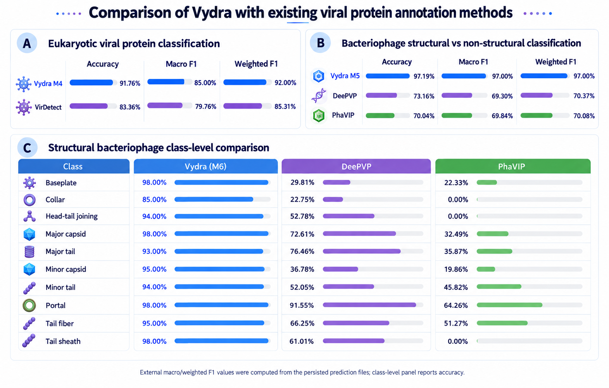

<div align="center">
  <p>
    <a href="README.md"></a>
    <a href="README.es.md"></a>
  </p>
  
  <h1>Vydra</h1>
  <p><strong>Hierarchical protein classification and biological contextualization with ProstT5, MLPs, and FAISS.</strong></p>
  <p>
    
    
    
    
  </p>
</div>

Vydra takes a protein sequence through a cascade of six classifiers. It separates
cellular from viral proteins, distinguishes bacteriophages from eukaryotic
viruses, and identifies structural phage proteins and their functional class.
For phage predictions, it also searches reference neighborhoods to provide
interpretable biological context.

> **Status:** active research project. FAISS assignments provide similarity-based
> context and should not be interpreted as direct taxonomic classification of a
> query sequence.



## What Vydra predicts

All six classifiers share a 1,024-dimensional ProstT5 embedding:

| Model | Decision |
|---|---|
| M1 | Viral or cellular |
| M2 | Bacteria, Archaea, or Eukaryota |
| M3 | Bacteriophage or eukaryotic virus |
| M4 | One of 978 eukaryotic-virus classes |
| M5 | Structural or non-structural phage protein |
| M6 | One of 10 structural phage classes |

The structural classes are `baseplate`, `collar`, `head_tail_joining`,
`major_capsid`, `major_tail`, `minor_capsid`, `minor_tail`, `portal`,
`tail_fiber`, and `tail_sheath`.

## Hardware and execution modes

The local runtime supports Linux and Python 3.10 with either CPU or CUDA inference. The selected device applies to ProstT5, classifiers, and FAISS together.

| Use | GPU | Minimum system RAM* | Recommended system RAM | Practical guidance |
|---|---|---|---|---|
| GPU inference | NVIDIA CUDA GPU; validated on RTX 3060 12 GB | 16 GB | 32 GB | Install `environment.yml`. Smaller GPUs have not been certified. |
| CPU inference | None required | 16 GB | 32 GB | Install `environment-cpu.yml`. All stages run on CPU; expect longer runtimes. |
| GUI / saved reports | None required | No inference RAM requirement | Depends on report size and browser | Viewing reports does not load the inference models. |

\* **16 GB is an estimated practical minimum for small inputs with batch size 1, not a guaranteed absolute minimum for every workload.** A complete two-protein run measured peak process RAM of 7.54 GiB on CPU and 7.97 GiB on GPU; the operating system, browser, and other applications need additional memory. GPU execution still uses host RAM while loading the model and reference banks. Use `--batch-size 1` on memory-constrained machines (or Batch size = 1 in the GUI). Larger collections, long sequences, and larger batches can require more than 16 GB. **32 GB is recommended, not mandatory.** A full run on a physical 16 GB machine has not yet been validated. See [RAM measurements](docs/CPU_GPU_VALIDATION.md#ram-measurements).

For a CPU-only installation:

```bash
conda env create -f environment-cpu.yml
conda activate vydra-cpu
./vydra doctor
./vydra gui
```

The GPU environment also supports CPU execution. Install one FAISS variant per environment; `faiss-gpu` already includes CPU indexes.

Allow approximately **25 GB of free disk** for the environment, model cache, reference banks, and small runs; large input/output collections need additional space. The pinned encoder cache occupies about 5.3 GB and the two FAISS prototype banks about 1.6 GB. These RAM/disk values are planning guidance, not universal minimum guarantees. Protein length, batch size, other GPU workloads, and result size change memory use. The [RTX 3060 benchmark](docs/BATCH_BENCHMARK_RTX3060.md) documents the validated GPU baseline. Automatic batching adapts to available memory; use a smaller batch if needed.

## Local models and downloads

**All inference runs locally.** Vydra never sends your proteins to an online inference API. It looks for models in this order:

1. An explicitly configured `VYDRA_PROSTT5_PATH`.
2. `vydra_core/models/prostt5/`, if complete.
3. The local Hugging Face cache for the pinned `Rostlab/ProstT5_fp16` snapshot.
4. Only if missing and permitted: download missing files once, cache them, then run locally.

The GUI always prefers local files. **Allow model downloads** only controls step 4; it does not choose a remote model or force a fresh download. Disable it, or use CLI `--offline`, to prohibit downloads. Missing local files then produce a clear error. **Check installation** is optional and does not enable local models. Reference banks are installed separately with `./vydra download-artifacts`; model loading never silently replaces them.

## Quick start

### 1. Clone and install

```bash
git clone https://github.com/Maxdesigna7x/Vydra.git
cd Vydra
conda env create -f environment.yml
conda activate vydra
```

### 2. Download the large artifacts

The MLP weights are included in the repository. The FAISS prototype banks are
published separately in GitHub Releases because together they occupy about 1.6
GB:

```bash
./vydra download-artifacts
```

Raw protein sequences also require ProstT5. Downloading it once stores a local
copy inside the bundle for later offline use:

```bash
./vydra download-model
./vydra doctor
```

For a private clone, `download-artifacts` automatically uses an authenticated
GitHub CLI session. Run `gh auth login` first when needed.

### 3. Run a prediction

```bash
./vydra predict --seq "MSTNPKPQRKTKRNTNRRPQDVKFPGGGQIVGGVYLLPRRGPRLG"
```

FASTA input and CSV output:

```bash
./vydra predict --fasta proteins.fasta --format csv --output predictions.csv
```

Read FASTA from a pipe:

```bash
cat proteins.fasta | ./vydra predict --stdin --format jsonl
```

Use existing 1,024-dimensional ProstT5 embeddings without loading the base
model:

```bash
./vydra predict --embedding embeddings.npy --offline --format json
```

The CLI supports `table`, `json`, `jsonl`, and `csv` output. It detects CUDA
automatically, while `--device cpu` and `--device cuda` provide explicit control.

`--device auto` selects CUDA when both PyTorch and GPU FAISS can initialize; otherwise it selects CPU for every stage. `--device cpu` requires no CUDA. `--device cuda` requires a working GPU backend and reports an error if unavailable. CPU and GPU FAISS use float32 inner-product indexes with the same normalization and thresholds. Small floating-point differences can affect ties or predictions exactly at a threshold.

Batching is memory-aware by default: Vydra sorts chunks by real sequence length,
groups similar lengths, checks currently available VRAM or RAM after loading the
encoder, and preserves a safety reserve. The initial GPU limits are calibrated
from an RTX 3060 benchmark (11.63 GiB), then scaled to the detected device. If
memory is fragmented or another process consumes memory, Vydra halves the batch
and retries automatically. Advanced controls are available through
`--batch-size`, `--max-batch-size`, `--memory-fraction`,
`--reserve-memory-gb`, and `--length-bin`.

## Local graphical interface

Vydra includes a local browser interface for running protein inference without writing CLI commands. Launch it from the installed environment:

```bash
conda activate vydra
./vydra gui
```



The English interface includes:

- **Compact dark/light layout:** input and output share a row, with the main workflow fitting into one desktop viewport.
- **Local input selection:** browse for one protein FASTA file or a folder searched recursively; original IDs, headers, files, and folders remain traceable.
- **Advanced settings:** automatic/CUDA/CPU model device, batch size, permission to download missing models, and optional generation of the interactive inference report.
- **Run monitoring:** current phase, actual classified-protein counts when available, elapsed time, live logs, and cancellation.
- **Local history:** revisit previous runs and their output locations. New runs require a new or empty output folder to protect existing results.
- **Help:** explanatory tooltips, an installation check, and a usage FAQ covering input preparation and biological interpretation.

The server runs on `127.0.0.1` and uses the installed Python environment. Keep its terminal open; closing the browser tab leaves inference running. Offline mode requires models and reference artifacts to be available locally. The device selection applies to models and FAISS; CPU inference requires no GPU.

To choose a port and open the URL manually:

```bash
./vydra gui --no-browser --port 8732
```

See the [GUI guide](vydra_core/GUI.md) and [usage FAQ](docs/GUI_FAQ.md). Completed runs open the interactive results report, with folder/file filtering, three classification views, sortable tables, and selected CSV downloads.

## How it works

```text
Protein sequence
      │
      ▼
ProstT5 → 1,024-dimensional embedding
      │
      ▼
M1: cellular ─────────────► M2: Bacteria / Archaea / Eukaryota
 │
 └── viral ───────────────► M3: eukaryotic virus / bacteriophage
                              │                    │
                              ▼                    ▼
                         M4: 978 classes     M5: structural / non-structural
                                                   │
                                                   ▼
                                             M6: 10 classes
                                                   │
                                                   ▼
                                      FAISS + biological context
```

Sequences longer than 2,048 amino acids are split into overlapping windows and
their embeddings are averaged. The final search uses inner product over
normalized vectors and class-specific prototype banks.



## Experimental performance

Across the internal test sets used during development, the six local classifier
heads achieved accuracies between 91.76% and 99.31%. These values describe each
head under its own evaluation split; they are not a claim of end-to-end accuracy
on every external distribution.



The project also compares Vydra with established protein-annotation approaches.
Interpret this figure together with the evaluation protocol and dataset scope;
different tools may solve partially different tasks.




## Offline execution

After `download-artifacts` and `download-model`, inference can run without
network access:

```bash
./vydra predict --offline --fasta proteins.fasta
```

You may also point Vydra to an existing local ProstT5 installation:

```bash
export VYDRA_PROSTT5_PATH=/local/path/to/ProstT5
./vydra predict --offline --fasta proteins.fasta
```

## Repository layout

```text
Vydra/
├── vydra                       # CLI / GUI launcher
├── environment.yml             # CUDA and GPU FAISS environment
├── requirements.txt            # local runtime Python dependencies
├── vydra_core/
│   ├── engine.py               # ProstT5 + MLP + CPU/GPU FAISS, no web-framework dependency
│   ├── vydra_cli.py             # commands and output formats
│   ├── local_gui.py             # loopback browser interface
│   ├── gui/                    # local GUI assets
│   ├── report/                 # interactive results template
│   ├── models/mlp_weights/     # bundled classifier weights
│   └── artifacts/              # reference metadata and downloaded banks
├── tests/
└── docs/
```


## Embedding format

The CLI accepts NumPy matrices with shape `(n, 1024)` or PyTorch dictionaries.
The nested format used by the project is:

```python
{
    "class_name": {
        "sequence_id": torch.Tensor(shape=(1024,))
    }
}
```

## Limitations

- Performance depends on the coverage and distribution of the reference data.
- High MLP confidence does not replace independent biological validation.
- A cluster label summarizes known neighbors; it does not establish taxonomy.
- ProstT5 and the prototype banks require several GB of storage.
- Embeddings and classifiers can run on CPU; current inference still requires CUDA GPU FAISS.

## Documentation

- [CLI guide](vydra_core/CLI.md)
- [RTX 3060 batch-limit benchmark](docs/BATCH_BENCHMARK_RTX3060.md)
- [Versión en español](README.es.md)

## Citation

Vydra is part of an ongoing thesis project. A formal citation will be added when
the manuscript becomes available. Until then, please link to this repository
and record the commit used in your analysis.
